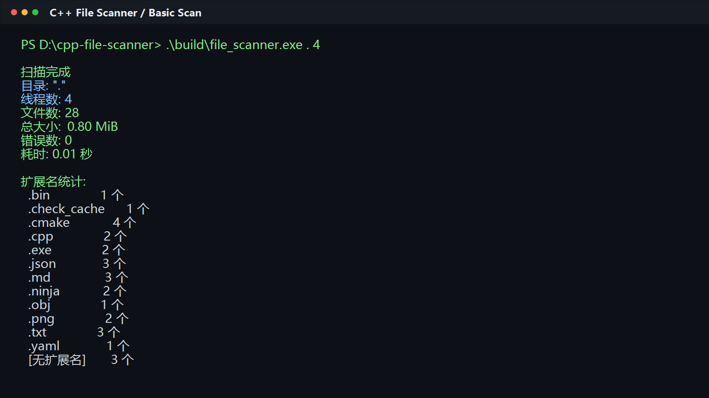
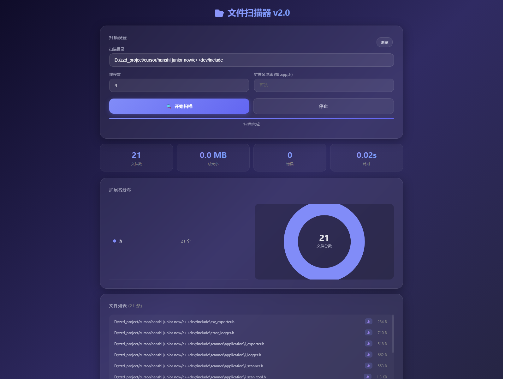
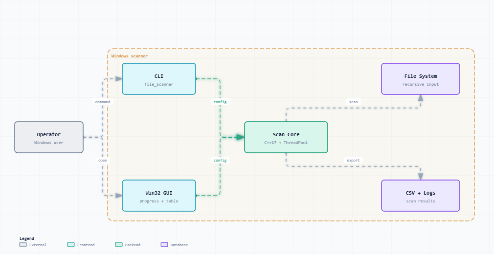

# C++ 多线程文件扫描器 v2.0

面向 C++ 开发实习准备的 Windows 桌面工具，v2.0 采用 Clean Architecture 三层架构，集成了重复文件检测、SQLite 持久化、JSON 输出和 Treemap 可视化。

## 项目状态

**v2.0 完成，已实现的全部功能：**

### 核心扫描
- 递归目录扫描 + 多线程文件处理
- 有界线程池（生产者-消费者，队列背压）
- 扩展名/文件大小过滤
- 线程安全错误日志
- CSV 导出（UTF-8 BOM）
- 性能基准（1/2/4/8 线程）

### v2.0 新增
- **架构**：Clean Architecture 三层分层（Domain/Application/Infrastructure）
- **测试**：56 个单元测试，4 组，100% 通过
- **CI/CD**：GitHub Actions 跨平台（Win/Mac/Linux）
- **重复检测**：SHA256 三级策略（大小→64KB→完整文件）
- **数据库**：SQLite 持久化（保存/加载/历史/对比）
- **JSON 输出**：`--json` 结构化格式
- **Treemap**：GUI 底部可视化面板，按扩展名着色
- **文件监听**：ReadDirectoryChangesW 实时监听
- **清理操作**：回收站 / 永久删除
- **Web GUI**：嵌入式 HTTP 服务 + 浏览器玻璃拟态界面（[截图](docs/screenshots/17-v2-web-gui.png)）
- **重复检测增强**：NameAndSize 快速模式（文件名+大小零 I/O 分桶）+ 预哈希 SQLite 缓存（二次扫描秒开）
- **删除策略扩展**：保留最新/最旧/最大/最小 + 参考目录保护
- **插件化工具**：IScanTool 接口 + ToolRegistry，新增工具零改动现有代码

详细更新见：[CHANGELOG.md](CHANGELOG.md) | 开发计划：[docs/开发计划.md](docs/开发计划.md)

## 技术栈

- C++17
- STL：`std::filesystem`、`std::thread`、`std::mutex`、`std::condition_variable`、`std::atomic`
- MSYS2 UCRT64 GCC 16.1.0
- CMake 4.4.0
- Ninja 1.13.2
- GDB
- VS Code
- Windows Win32 API

## 功能演示

### v1.0 基础功能





### v2.0 新功能



启动 `file_scanner_web.exe` 后自动打开浏览器（默认 http://localhost:8899），玻璃拟态深色 UI，支持：
- `?autoscan=1&path=...&threads=...` URL 参数自动扫描（便于分享/演示）
- 三级 SHA256 分桶（大小 → 64KB → 完整哈希）
- 环形饼图展示扩展名占比
- Web 端导出 CSV / JSON / Word 报告

更多截图（CLI / GUI / 综合）：

| 功能 | 截图 | 捕获命令 |
|------|------|----------|
| 测试结果 | `09-v2-test-results.png` | `ctest --test-dir build --output-on-failure` |
| 帮助信息 | `10-v2-help.png` | `file_scanner.exe --help` |
| 重复检测 | `11-v2-dupes.png` | `file_scanner.exe . 4 --dupes` |
| JSON 输出 | `12-v2-json.png` | `file_scanner.exe . 4 --json output.json` |
| 历史列表 | `13-v2-db-list.png` | `file_scanner.exe --db scan.db --list-scans` |
| 扫描对比 | `14-v2-compare.png` | `file_scanner.exe . 4 --db scan.db --compare <id>` |
| GUI Treemap | `15-v2-gui-treemap.png` | 双击 `file_scanner_gui.exe` 扫描后截图 |
| 全功能综合 | `16-v2-cli-all.png` | 所有选项同时启用 |

> 截图规范见 [docs/screenshots/README.md](docs/screenshots/README.md)

## 项目结构

```text
.
├── .github/workflows/ci.yml    # GitHub Actions 跨平台 CI
├── .clang-format               # 代码规范
├── CHANGELOG.md                # 版本变更记录
├── Doxyfile                    # API 文档生成
├── include/scanner/
│   ├── domain/                 # 核心数据类型 + 纯函数
│   ├── application/            # 接口定义 + 线程池
│   └── infrastructure/         # 具体实现
├── src/scanner/                # （同上的三层结构）
├── tests/                      # 56 个单元测试
├── scripts/
└── docs/
```

## 编译

当前项目使用安装在 `F:\msys64` 的 UCRT64 GCC、CMake 和 Ninja。

```powershell
$env:PATH = "F:\msys64\ucrt64\bin;F:\msys64\usr\bin;$env:PATH"
cmake -G Ninja -S . -B build -DCMAKE_BUILD_TYPE=Release
cmake --build build
```

## 运行

扫描当前目录：

```powershell
.\build\file_scanner.exe . 4
```

扫描指定目录：

```powershell
.\build\file_scanner.exe "D:\资料" 8
```

按扩展名和大小过滤：

```powershell
.\build\file_scanner.exe . 4 --ext .cpp,.h --min-size 1024 --max-size 10485760
```

将错误详情追加到日志文件：

```powershell
.\build\file_scanner.exe . 4 --log .\logs\scan-errors.log
```

导出匹配文件元数据到 CSV：

```powershell
.\build\file_scanner.exe . 4 --output .\output\scan.csv
```

运行 1/2/4/8 线程性能对比，每组默认重复 3 次：

```powershell
powershell.exe -NoProfile -ExecutionPolicy Bypass -File ".\scripts\benchmark.ps1" -ScanPath ".\src"
```

结果保存到 `output/benchmark.csv`，包含平均、最快、最慢墙钟耗时、文件数、错误数和文件/MiB 吞吐量。自定义线程组时使用逗号字符串，例如 `-ThreadCounts "1,2,4"`。

启动 Windows 原生 GUI 页面：

```powershell
.\build\file_scanner_gui.exe
```

GUI 页面支持选择扫描目录、设置线程数、输入扩展名过滤和最小/最大文件字节数，再启动后台扫描；完成后在浅蓝色主题页面中展示文件数量、总大小、错误数和包含扩展名、文件数、占比的统计表格。也可以在 VS Code 的“运行和调试”配置中选择“启动文件扫描器 GUI”。

### v2.0 新增功能

```powershell
# 查看完整帮助
.\build\file_scanner.exe --help

# 重复文件检测
.\build\file_scanner.exe . 4 --dupes

# JSON 格式输出
.\build\file_scanner.exe . 4 --json .\output\scan.json

# SQLite 数据库保存 + 查看历史
.\build\file_scanner.exe . 4 --db .\output\scan.db
.\build\file_scanner.exe --db .\output\scan.db --list-scans

# 扫描历史对比
.\build\file_scanner.exe . 4 --db .\output\scan.db --compare <scan_id>
```

参数说明：

1. 第一个位置参数是扫描目录，省略时扫描当前目录；也可以使用 `--path`。
2. 第二个位置参数是工作线程数，省略时根据 CPU 自动选择，范围为 1 到 64；也可以使用 `--threads`。
3. `--ext` 接收逗号分隔的扩展名列表，支持省略点号，例如 `cpp,h`。
4. `--min-size` 和 `--max-size` 的单位均为字节，两个参数可以单独使用。
5. `--log` 指定错误日志文件；日志采用 UTF-8 文本格式，目录不存在时会自动创建。
6. `--output` 指定 CSV 输出文件；输出目录不存在时会自动创建，每个匹配文件占一行。
7. 参数同时支持空格和等号形式，例如 `--threads 4`、`--threads=4`；常用短参数为 `-p`、`-t`、`-e`、`-o`。
8. 保留位置参数兼容写法：`file_scanner.exe . 4` 等价于 `--path . --threads 4`。

## 技术实现

共享扫描引擎负责遍历目录，先按扩展名过滤，再将候选文件路径放入有界线程安全队列；工作线程读取文件大小并执行大小范围过滤，最后保存匹配文件的路径、大小和扩展名元数据。队列达到容量后，生产者会等待工作线程消费任务，从而避免大目录扫描时任务无限堆积。命令行和 Win32 GUI 共用同一套扫描引擎，队列关闭后，工作线程会处理完剩余任务再退出。

当前实现重点体现：

- 生产者-消费者模型
- 独立线程池和通用 `enqueue()` 任务提交接口
- 队列容量限制、满载等待和关闭唤醒
- 扩展名规范化、文件大小范围过滤和元数据记录
- 错误结果结构化收集，`ErrorLogger` 使用互斥锁保证多线程追加安全
- `CsvExporter` 输出 UTF-8 BOM、中文表头和逐文件元数据，并转义逗号、双引号与换行
- 命令行解析统一处理长短参数、等号形式、默认线程数和非法参数提示
- `scripts/benchmark.ps1` 固定执行 1/2/4/8 线程并重复测量，用墙钟时间计算吞吐量，同时校验各线程结果一致
- 互斥锁和条件变量
- 原子计数器
- `std::filesystem` 错误码处理
- Windows 宽字符命令行入口和 UTF-8 路径显示
- Win32 原生窗口、目录选择和后台扫描线程
- CMake 可复现构建

## 测试结果

### 单元测试 (v2.0)

```powershell
ctest --test-dir build --output-on-failure
```

| 测试组 | 用例数 | 结果 |
|--------|--------|:--:|
| test_domain_utilities | 22 | ✅ |
| test_thread_pool | 13 | ✅ |
| test_csv_exporter | 9 | ✅ |
| test_file_scanner | 12 | ✅ |
| **合计** | **56** | **100%** |

### Smoke test (v1.0)

```powershell
powershell.exe -NoProfile -ExecutionPolicy Bypass -File ".\tests\smoke_tests.ps1"
```

> 最近结果：`Passed: 8  Failed: 0`

## 演示版交付与面试准备

- [演示版发布说明](docs/发布说明.md)：构建、五分钟演示、一键发布检查和已知限制。
- [面试总结](docs/面试总结.md)：项目介绍、架构讲解、并发/错误处理/性能问题和简历描述。

发布检查命令：

```powershell
powershell.exe -NoProfile -ExecutionPolicy Bypass -File ".\scripts\release_check.ps1" -ScanPath ".\src"
```

该命令使用独立的 `build-release-check/` 目录完成 Release 构建，不删除现有构建目录。

## 开发计划与截图规范

- [专业开发计划](docs/开发计划.md)
- [功能截图目录说明](docs/screenshots/README.md)

每完成一个功能，按照以下顺序更新项目：

```text
实现功能
→ 编译验证
→ 运行验证
→ 保存截图
→ 更新截图说明
→ 更新 README
```

## 后续路线

v2.0 15 天计划已全部完成。未来可选方向：

- 跨平台 GUI（Qt6 / imgui）
- TCP 远程扫描代理（gRPC）
- DLL 插件系统
- 增量扫描（inotify/FSEvents 驱动）
- 文件哈希缓存加速

## 动态系统架构图



- [打开交互式动态架构图](docs/architecture/dynamic-archify-architecture.html)
- [查看架构源数据](docs/architecture/dynamic-archify-architecture.json)
