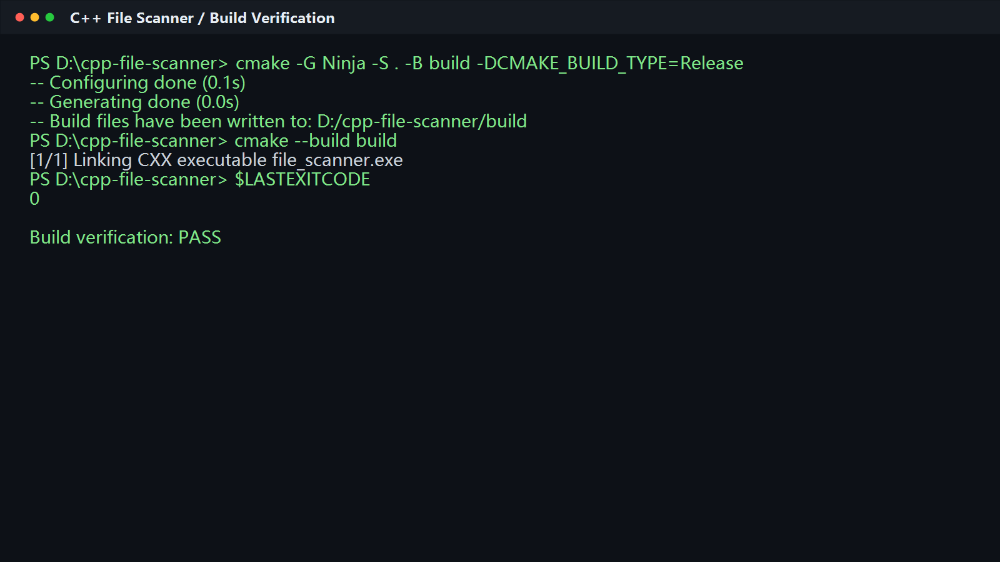
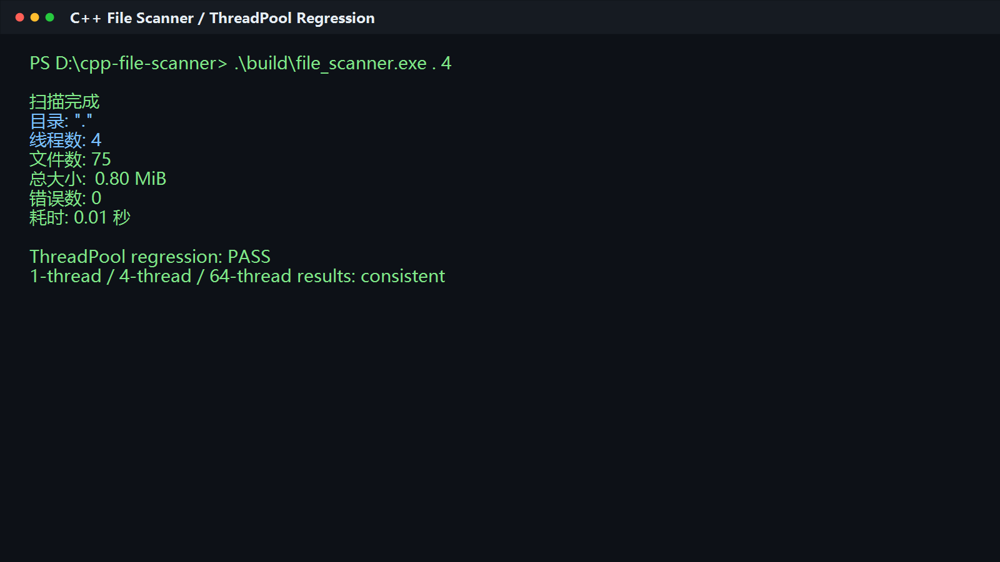
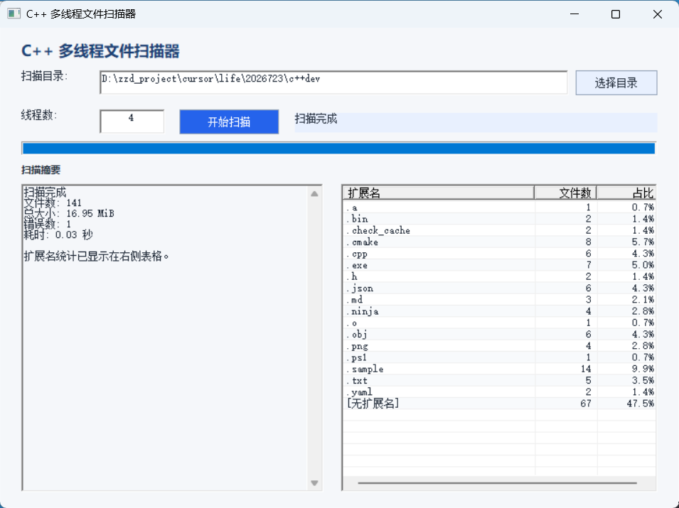

# C++ 多线程文件扫描器

一个面向 C++ 开发实习准备的 Windows 命令行工具项目，用于练习 C++17、STL、文件系统、多线程、线程同步、CMake 和工程化文档。

## 项目状态

当前版本为基础可运行版，已经完成：

- 递归扫描目录
- 多线程文件处理
- 线程安全任务队列
- 有界任务队列和优雅关闭
- 独立 `ThreadPool` 线程池模块
- 文件数量、总大小和错误数统计
- 文件扩展名统计
- 扩展名和文件大小过滤
- 匹配文件的路径、大小和扩展名元数据记录
- 线程安全错误收集与可选日志文件输出
- CSV 文件导出，支持 UTF-8 中文和特殊字符转义
- 统一长参数/短参数配置和参数错误提示
- 1/2/4/8 线程性能基准脚本和吞吐量统计
- 可重复执行的 Windows smoke test 和完整验收清单
- v1.0.0-demo 发布说明和面试总结
- Windows 原生 Win32 GUI 页面
- GUI 动态进度条、浅蓝色主题和扩展名统计表格
- C++17 + CMake + Ninja 构建
- 基础构建和运行截图

已提供可重复的 Windows smoke test；更大规模压力测试仍可继续扩展。

详细计划见：[docs/开发计划.md](docs/开发计划.md)

## 技术栈

- C++17
- STL：`std::filesystem`、`std::thread`、`std::mutex`、`std::condition_variable`、`std::atomic`
- MSYS2 UCRT64 GCC 16.1.0
- CMake 4.4.0
- Ninja 1.13.2
- GDB
- VS Code
- Windows Win32 API

## 功能演示

### 构建成功



### 基础扫描


### 线程池回归验证



### GUI 进度条、主题和扩展名表格



## 项目结构

```text
.
├── .vscode/
├── docs/
│   ├── 开发计划.md
│   ├── 发布说明.md
│   ├── 面试总结.md
│   └── screenshots/
│       ├── README.md
│       ├── 01-build-success.png
│       ├── 02-basic-scan.png
│       ├── 03-multithread-scan.png
│       └── 08-gui-progress-theme-table.png
├── include/
│   ├── csv_exporter.h
│   ├── error_logger.h
│   ├── scan_engine.h
│   └── thread_pool.h
├── src/
│   ├── csv_exporter.cpp
│   ├── error_logger.cpp
│   ├── main.cpp
│   ├── gui_main_win32.cpp
│   ├── scan_engine.cpp
│   └── thread_pool.cpp
├── scripts/
│   ├── benchmark.ps1
│   └── release_check.ps1
├── tests/
│   ├── README.md
│   └── smoke_tests.ps1
├── CMakeLists.txt
├── README.md
└── .gitignore
```

## 编译

当前项目使用安装在 `F:\msys64` 的 UCRT64 GCC、CMake 和 Ninja。

```powershell
$env:PATH = "F:\msys64\ucrt64\bin;F:\msys64\usr\bin;$env:PATH"
cmake -G Ninja -S . -B build -DCMAKE_BUILD_TYPE=Release
cmake --build build
```

## 运行

扫描当前目录：

```powershell
.\build\file_scanner.exe . 4
```

扫描指定目录：

```powershell
.\build\file_scanner.exe "D:\资料" 8
```

按扩展名和大小过滤：

```powershell
.\build\file_scanner.exe . 4 --ext .cpp,.h --min-size 1024 --max-size 10485760
```

将错误详情追加到日志文件：

```powershell
.\build\file_scanner.exe . 4 --log .\logs\scan-errors.log
```

导出匹配文件元数据到 CSV：

```powershell
.\build\file_scanner.exe . 4 --output .\output\scan.csv
```

运行 1/2/4/8 线程性能对比，每组默认重复 3 次：

```powershell
powershell.exe -NoProfile -ExecutionPolicy Bypass -File ".\scripts\benchmark.ps1" -ScanPath ".\src"
```

结果保存到 `output/benchmark.csv`，包含平均、最快、最慢墙钟耗时、文件数、错误数和文件/MiB 吞吐量。自定义线程组时使用逗号字符串，例如 `-ThreadCounts "1,2,4"`。

启动 Windows 原生 GUI 页面：

```powershell
.\build\file_scanner_gui.exe
```

GUI 页面支持选择扫描目录、设置线程数、输入扩展名过滤和最小/最大文件字节数，再启动后台扫描；完成后在浅蓝色主题页面中展示文件数量、总大小、错误数和包含扩展名、文件数、占比的统计表格。也可以在 VS Code 的“运行和调试”配置中选择“启动文件扫描器 GUI”。

参数说明：

1. 第一个位置参数是扫描目录，省略时扫描当前目录；也可以使用 `--path`。
2. 第二个位置参数是工作线程数，省略时根据 CPU 自动选择，范围为 1 到 64；也可以使用 `--threads`。
3. `--ext` 接收逗号分隔的扩展名列表，支持省略点号，例如 `cpp,h`。
4. `--min-size` 和 `--max-size` 的单位均为字节，两个参数可以单独使用。
5. `--log` 指定错误日志文件；日志采用 UTF-8 文本格式，目录不存在时会自动创建。
6. `--output` 指定 CSV 输出文件；输出目录不存在时会自动创建，每个匹配文件占一行。
7. 参数同时支持空格和等号形式，例如 `--threads 4`、`--threads=4`；常用短参数为 `-p`、`-t`、`-e`、`-o`。
8. 保留位置参数兼容写法：`file_scanner.exe . 4` 等价于 `--path . --threads 4`。

## 技术实现

共享扫描引擎负责遍历目录，先按扩展名过滤，再将候选文件路径放入有界线程安全队列；工作线程读取文件大小并执行大小范围过滤，最后保存匹配文件的路径、大小和扩展名元数据。队列达到容量后，生产者会等待工作线程消费任务，从而避免大目录扫描时任务无限堆积。命令行和 Win32 GUI 共用同一套扫描引擎，队列关闭后，工作线程会处理完剩余任务再退出。

当前实现重点体现：

- 生产者-消费者模型
- 独立线程池和通用 `enqueue()` 任务提交接口
- 队列容量限制、满载等待和关闭唤醒
- 扩展名规范化、文件大小范围过滤和元数据记录
- 错误结果结构化收集，`ErrorLogger` 使用互斥锁保证多线程追加安全
- `CsvExporter` 输出 UTF-8 BOM、中文表头和逐文件元数据，并转义逗号、双引号与换行
- 命令行解析统一处理长短参数、等号形式、默认线程数和非法参数提示
- `scripts/benchmark.ps1` 固定执行 1/2/4/8 线程并重复测量，用墙钟时间计算吞吐量，同时校验各线程结果一致
- 互斥锁和条件变量
- 原子计数器
- `std::filesystem` 错误码处理
- Windows 宽字符命令行入口和 UTF-8 路径显示
- Win32 原生窗口、目录选择和后台扫描线程
- CMake 可复现构建

## 测试结果

基础验证命令：

```powershell
cmake -G Ninja -S . -B build -DCMAKE_BUILD_TYPE=Release
cmake --build build
.\build\file_scanner.exe . 4
```

当前基础验证结果：

- 编译成功
- 程序正常退出
- 扫描文件数和扩展名统计正常
- 错误数为 0
- 多线程参数可用
- 中文非法目录能够返回可读错误并以退出码 1 结束
- 1、4、64 线程扫描结果一致
- 有界队列不会丢失任务，关闭后工作线程能够正常退出
- 扩展名过滤、最小/最大字节过滤结果与文件实际大小一致
- 非法目录会返回明确错误，并在指定 `--log` 时写入带时间、路径和原因的日志
- 扫描过程中的可恢复错误会继续处理其他任务，CLI 和 GUI 展示最多 10 条错误详情
- CSV 导出记录数与元数据记录数一致，路径和扩展名字段遵循 CSV 转义规则
- 长短参数、位置参数、缺少参数值、空路径、线程数边界和未知参数均已验证
- 性能脚本已验证默认 4 组线程、重复运行结果一致，且 `output/benchmark.csv` 行数为 4

完整 smoke test：

```powershell
powershell.exe -NoProfile -ExecutionPolicy Bypass -File ".\tests\smoke_tests.ps1"
```

测试脚本覆盖基础扫描、1/4/64 线程一致性、空目录、非法目录、过滤、CSV、日志、参数边界、1/2/4/8 性能脚本和 GUI 启动；最近一次结果为 `Passed: 8  Failed: 0`。

详细测试说明见：[tests/README.md](tests/README.md)。

## 演示版交付与面试准备

- [演示版发布说明](docs/发布说明.md)：构建、五分钟演示、一键发布检查和已知限制。
- [面试总结](docs/面试总结.md)：项目介绍、架构讲解、并发/错误处理/性能问题和简历描述。

发布检查命令：

```powershell
powershell.exe -NoProfile -ExecutionPolicy Bypass -File ".\scripts\release_check.ps1" -ScanPath ".\src"
```

该命令使用独立的 `build-release-check/` 目录完成 Release 构建，不删除现有构建目录。

## 开发计划与截图规范

- [专业开发计划](docs/开发计划.md)
- [功能截图目录说明](docs/screenshots/README.md)

每完成一个功能，按照以下顺序更新项目：

```text
实现功能
→ 编译验证
→ 运行验证
→ 保存截图
→ 更新截图说明
→ 更新 README
```

## 后续路线

1. 完善自动化测试和压力测试。
2. 增加修改时间过滤。
3. 后续扩展数据库、网络和更丰富的 Windows API 能力。

## 动态系统架构图


- [打开交互式动态架构图](docs/architecture/dynamic-archify-architecture.html)
- [查看架构源数据](docs/architecture/dynamic-archify-architecture.json)
