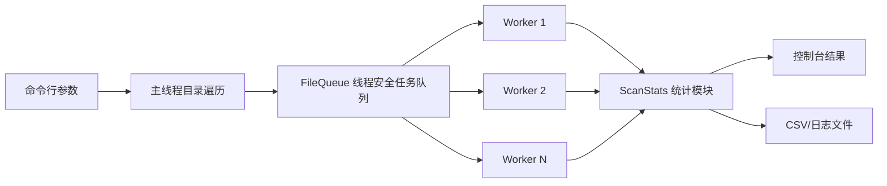

# C++ 多线程文件扫描器开发计划

## 1. 项目基本信息

| 项目项 | 内容 |
| --- | --- |
| 项目名称 | C++ 多线程文件扫描器 |
| 项目版本 | v0.1 基础版，向 v1.0 实习展示版迭代 |
| 项目类型 | Windows 命令行工具 |
| 项目负责人 | 项目开发者 |
| 当前状态 | 已完成基础扫描、并发处理、扩展名统计和 CMake 构建 |
| 开发周期 | 10 天冲刺开发 |
| 主要平台 | Windows 10/11，64 位 |

## 2. 项目背景与目标

### 2.1 项目背景

本项目用于训练 C++ 开发实习所需的工程能力，围绕文件系统、线程同步、任务队列、错误处理、构建工具和性能验证，逐步形成一个可以独立讲解和演示的 Windows C++ 项目。

### 2.2 开发目标

- 使用 C++17 完成稳定的递归文件扫描工具。
- 使用多线程处理文件元数据，理解生产者-消费者模型。
- 使用 CMake 和 Ninja 建立可复现的构建流程。
- 增加过滤、日志、CSV 导出和性能对比等实用功能。
- 建立测试、截图、README 和开发计划，形成完整项目交付物。
- 能够在面试中清晰说明线程模型、数据同步、异常场景和性能取舍。

### 2.3 非目标

10 天冲刺阶段不优先开发复杂 GUI、MySQL 业务层、音视频编解码和鸿蒙适配。这些内容作为后续扩展，不影响当前命令行版本的交付。

## 3. 技术栈与工程约束

| 分类 | 选型 |
| --- | --- |
| 编程语言 | C++17 |
| 标准库 | STL、`std::filesystem`、`std::thread`、`std::mutex`、`std::condition_variable`、`std::atomic` |
| 编译器 | MSYS2 UCRT64 GCC 16.1.0 |
| 构建工具 | CMake 4.4.0、Ninja 1.13.2 |
| 调试工具 | GDB |
| 开发环境 | VS Code |
| 版本管理 | Git，提交信息使用中文 |
| 产物管理 | `build/` 仅用于本地构建，不进入版本库 |

## 4. 当前版本基线

当前版本已经具备以下能力：

- 递归遍历目标目录。
- 使用线程安全队列向工作线程分发文件路径。
- 使用多个工作线程读取文件大小。
- 统计文件总数、总大小、错误数和扩展名分布。
- 支持扫描目录和线程数命令行参数。
- 支持 CMake + Ninja 编译。
- Windows 中文命令行路径能够正常显示错误信息，不因窄字符编码转换崩溃。

当前限制：

- 任务队列暂未设置容量上限。
- 过滤条件、日志文件和 CSV 导出尚未完成。
- 暂无自动化测试和性能基准脚本。
- 当前仅提供命令行界面。

## 5. 系统架构与数据流



核心设计原则：

1. 主线程负责目录遍历和任务生产。
2. 工作线程负责文件信息读取和统计。
3. 队列通过互斥锁和条件变量保证线程安全。
4. 计数器使用原子变量，扩展名映射使用互斥保护。
5. 扫描结束后关闭队列，工作线程处理完剩余任务后有序退出。

## 6. 10 天开发计划

| 天数 | 当日目标 | 具体开发内容 | 预计修改范围 | 验收命令 | 功能截图 | 完成标准 |
| --- | --- | --- | --- | --- | --- | --- |
| 第 1 天 | 熟悉代码和构建流程 | 阅读主流程、队列、统计结构；确认编译和运行命令 | `src/main.cpp`、README | `cmake -G Ninja -S . -B build -DCMAKE_BUILD_TYPE=Release; cmake --build build; .\build\file_scanner.exe . 4` | `01-build-success.png`、`02-basic-scan.png` | 能独立解释数据流，基础扫描成功 |
| 第 2 天 | 抽离线程池模块 | 将线程创建、任务获取、线程退出逻辑抽离为 `ThreadPool` | `include/`、`src/`、`CMakeLists.txt` | 编译后使用线程池扫描当前目录 | `03-multithread-scan.png` | 线程池可复用，线程能正常退出 |
| 第 3 天 | 控制队列和优雅退出 | 增加队列容量限制、关闭状态和异常退出处理 | `ThreadPool`、`FileQueue` | 扫描大目录并检查进程正常结束 | `03-multithread-scan.png` | 无死锁、无任务丢失、无异常崩溃 |
| 第 4 天 | 增加过滤和文件元数据 | 支持扩展名、最小/最大文件大小和修改时间；保存文件路径与大小 | 扫描器、命令行参数、统计模块 | `file_scanner.exe . 4 --ext .cpp,.h` | `04-filtered-scan.png` | 过滤结果与手工检查一致 |
| 第 5 天 | 增加错误日志 | 记录权限不足、路径不存在、读取失败等错误 | 日志模块、错误处理 | 使用非法路径和不可访问目录测试 | `07-error-handling.png` | 错误可定位，程序仍能完成可用任务 |
| 第 6 天 | 增加 CSV 导出 | 将扫描结果导出到 `output/scan.csv`，处理路径和特殊字符 | 导出模块、CMake | `file_scanner.exe . 4 --output output\scan.csv` | `05-csv-export.png` | CSV 文件可打开，行数和统计一致 |
| 第 7 天 | 完善命令行配置 | 统一 `--path`、`--threads`、`--ext`、`--output` 参数和帮助信息 | 参数解析、README | `file_scanner.exe --help` | `04-filtered-scan.png` | 参数错误有提示，默认值合理 |
| 第 8 天 | 完成性能对比 | 对比 1、2、4、8 线程耗时，记录吞吐量和限制 | benchmark 脚本、统计模块 | `scripts\benchmark.ps1` | `06-performance-test.png` | 有可复现实验数据并能解释结果 |
| 第 9 天 | 完善测试和项目文档 | 增加边界测试，整理目录、README、开发计划和截图 | `tests/`、`docs/`、README | 执行完整测试清单 | `01-build-success.png`、`02-basic-scan.png` | 文档无失效链接，测试结果可复现 |
| 第 10 天 | 发布演示版和面试总结 | 固化运行命令、整理项目亮点、准备技术问答 | README、开发计划、发布检查 | 清理后重新构建并完整演示 | `06-performance-test.png` | 能在 5 分钟内完成项目演示和技术说明 |

## 7. 测试计划

### 7.1 构建测试

```powershell
cmake -G Ninja -S . -B build -DCMAKE_BUILD_TYPE=Release
cmake --build build
```

### 7.2 功能测试

- 扫描当前目录。
- 扫描指定目录。
- 省略线程数，验证默认线程数。
- 使用 1、2、4、8 和 64 个线程运行。
- 扫描空目录。
- 扫描不存在的目录。
- 扫描包含无扩展名文件的目录。
- 扫描包含中文路径的目录。
- 验证文件数、总大小和扩展名统计。

### 7.3 并发与稳定性测试

- 多次重复扫描同一目录，结果应保持一致。
- 工作线程应在队列关闭后全部退出。
- 不允许出现死锁、崩溃或程序无法退出。
- 统计数据不能出现明显丢失或重复。

### 7.4 文档测试

- README 中所有截图引用必须对应真实文件。
- 开发计划中的验收命令与实际命令保持一致。
- 截图不包含账号、令牌和私人文件名。
- `build/` 和临时安装文件不进入版本库。

## 8. 风险与解决方案

| 风险 | 影响 | 解决方案 |
| --- | --- | --- |
| 大目录导致队列占用过多内存 | 内存增长 | 增加有界队列和生产者背压 |
| 权限不足或文件在扫描中被删除 | 统计失败 | 使用 `std::error_code`，记录错误后继续 |
| 线程数过多导致上下文切换 | 性能下降 | 限制线程数上限并进行基准测试 |
| 中文路径处理异常 | 文件无法访问或进程崩溃 | Windows 使用宽字符命令行入口，输出使用 UTF-8 路径字符串 |
| README 引用不存在的截图 | 项目展示不完整 | 只引用已验证并保存的截图 |
| 构建环境不一致 | 无法复现 | 固定 C++17、CMake、Ninja 和工具链说明 |

## 9. 最终交付清单

- [ ] 基础扫描功能稳定。
- [ ] 线程池和任务队列结构清晰。
- [ ] 过滤、日志、CSV 导出完成。
- [ ] 单线程和多线程性能数据完成。
- [ ] 构建命令可以复现。
- [ ] README 内容完整且包含真实功能截图。
- [ ] `docs/开发计划.md` 与实际开发进度同步。
- [ ] 截图目录有清晰命名和说明。
- [ ] 无敏感信息、无无效图片链接、无构建产物提交。

## 10. 后续扩展方向

完成 v1.0 后，可以继续增加：

- Windows GUI 或跨平台 GUI。
- SQLite/MySQL 结果存储。
- TCP 远程扫描任务。
- DLL 插件扫描器。
- 文件哈希和重复文件检测。
- 实时进度条和取消任务。
- Windows API、性能分析和崩溃转储。
