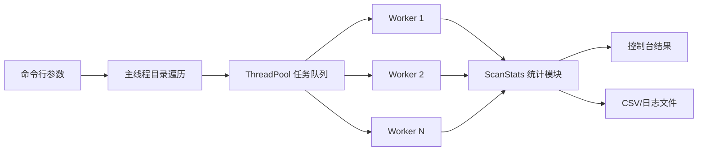

# C++ 多线程文件扫描器开发计划

## 1. 项目基本信息

| 项目项 | 内容 |
| --- | --- |
| 项目名称 | C++ 多线程文件扫描器 |
| 项目版本 | v0.1 基础版，向 v1.0 实习展示版迭代 |
| 项目类型 | Windows 命令行工具 + Win32 桌面 GUI |
| 项目负责人 | 项目开发者 |
| 当前状态 | v1.0.0-demo 演示版已完成：基础扫描、有界线程池、优雅退出、Win32 GUI、动态进度条、主题、扩展名表格、错误收集、日志、CSV 导出、命令行配置、性能基准和 smoke test |
| 开发周期 | 10 天冲刺开发 |
| 主要平台 | Windows 10/11，64 位 |

## 2. 项目背景与目标

### 2.1 项目背景

本项目用于训练 C++ 开发实习所需的工程能力，围绕文件系统、线程同步、任务队列、错误处理、构建工具和性能验证，逐步形成一个可以独立讲解和演示的 Windows C++ 项目。

### 2.2 开发目标

- 使用 C++17 完成稳定的递归文件扫描工具。
- 使用多线程处理文件元数据，理解生产者-消费者模型。
- 使用 CMake 和 Ninja 建立可复现的构建流程。
- 增加过滤、日志、CSV 导出和性能对比等实用功能。
- 建立测试、截图、README 和开发计划，形成完整项目交付物。
- 能够在面试中清晰说明线程模型、数据同步、异常场景和性能取舍。

### 2.3 非目标

10 天冲刺阶段不优先开发复杂 GUI、MySQL 业务层、音视频编解码和鸿蒙适配。本项目已先完成轻量 Win32 原生页面，复杂交互和跨平台 GUI 仍作为后续扩展。

## 3. 技术栈与工程约束

| 分类 | 选型 |
| --- | --- |
| 编程语言 | C++17 |
| 标准库 | STL、`std::filesystem`、`std::thread`、`std::mutex`、`std::condition_variable`、`std::atomic` |
| 编译器 | MSYS2 UCRT64 GCC 16.1.0 |
| 构建工具 | CMake 4.4.0、Ninja 1.13.2 |
| 调试工具 | GDB |
| 开发环境 | VS Code |
| 版本管理 | Git，提交信息使用中文 |
| 产物管理 | `build/` 仅用于本地构建，不进入版本库 |

## 4. 当前版本基线

当前版本已经具备以下能力：

- 递归遍历目标目录。
- 使用独立 `ThreadPool` 向工作线程分发文件处理任务。
- 使用多个工作线程读取文件大小。
- 统计文件总数、总大小、错误数和扩展名分布。
- 支持扩展名、最小/最大文件大小过滤，并保存匹配文件元数据。
- 支持扫描目录和线程数命令行参数，以及 `--path`、`--threads`、`--ext` 等选项。
- 支持结构化收集扫描错误，并通过 `--log` 将时间、路径和原因追加到 UTF-8 日志文件。
- 支持通过 `--output` 将匹配文件的路径、大小和扩展名导出为 UTF-8 CSV。
- 支持长参数、短参数、`--key=value` 形式和位置参数兼容写法，并对缺失值、空路径、线程数越界和未知参数给出提示。
- 提供 `tests/smoke_tests.ps1`，覆盖 CLI、CSV、错误日志、性能脚本和 GUI 启动等核心验收场景。
- 提供 `scripts/release_check.ps1`、发布说明和面试总结，用于 Release 构建、演示和面试复盘。
- 支持 CMake + Ninja 编译。
- 提供命令行和 Win32 原生 GUI 两个可执行入口。
- Windows 中文命令行路径能够正常显示错误信息，不因窄字符编码转换崩溃。

当前限制：

- 修改时间过滤尚未完成。
- 已提供可重复执行的 Windows smoke test；大规模压力测试和更细粒度单元测试仍可继续扩展。
- GUI 当前提供目录选择、线程数设置、扩展名和大小过滤、后台扫描、动态进度条、颜色主题、扩展名表格和错误详情展示，导出功能尚未完成。

## 5. 系统架构与数据流



核心设计原则：

1. 主线程负责目录遍历和任务提交。
2. 工作线程负责文件信息读取和统计。
3. 队列通过互斥锁和条件变量保证线程安全，并在达到容量上限时让生产者等待。
4. 计数器使用原子变量，扩展名映射使用互斥保护。
5. 扫描结束后关闭队列，工作线程处理完剩余任务后有序退出。

## 6. 10 天开发计划

| 天数 | 当日目标 | 具体开发内容 | 预计修改范围 | 验收命令 | 功能截图 | 完成标准 | 状态 |
| --- | --- | --- | --- | --- | --- | --- | --- |
| 第 1 天 | 熟悉代码和构建流程 | 阅读主流程、队列、统计结构；确认编译和运行命令 | `src/main.cpp`、README | `cmake -G Ninja -S . -B build -DCMAKE_BUILD_TYPE=Release; cmake --build build; .\build\file_scanner.exe . 4` | `01-build-success.png`、`02-basic-scan.png` | 能独立解释数据流，基础扫描成功 | 已完成 |
| 第 2 天 | 抽离线程池模块 | 将线程创建、任务获取、线程退出逻辑抽离为 `ThreadPool` | `include/`、`src/`、`CMakeLists.txt` | 编译后使用线程池扫描当前目录 | `03-multithread-scan.png` | 线程池可复用，线程能正常退出 | 已完成 |
| 第 3 天 | 控制队列和优雅退出 | 增加队列容量限制、关闭状态和异常退出处理 | `ThreadPool`、队列逻辑 | 扫描大目录并检查进程正常结束 | `03-multithread-scan.png` | 无死锁、无任务丢失、无异常崩溃 | 已完成 |
| 第 4 天 | 增加过滤和文件元数据 | 支持扩展名、最小/最大文件大小；保存文件路径、大小和扩展名；修改时间过滤顺延 | 扫描器、命令行参数、GUI、统计模块 | `file_scanner.exe . 4 --ext .cpp,.h --min-size 1024 --max-size 10485760` | `04-filtered-scan.png` | 过滤结果与手工检查一致 | 已完成 |
| 第 5 天 | 增加错误日志 | 使用线程安全 `ErrorLogger` 记录时间、路径和原因；扫描错误进入结果集合；CLI 支持 `--log`；GUI 展示错误详情 | `include/error_logger.h`、`src/error_logger.cpp`、扫描引擎、CLI、GUI、README | `file_scanner.exe . 4 --log logs/scan-errors.log`；再使用非法路径验证日志 | `07-error-handling.png`（待保存真实终端截图） | 错误可定位，程序仍能完成可用任务；日志无法打开时给出明确配置错误 | 已完成 |
| 第 6 天 | 增加 CSV 导出 | 新增 `CsvExporter` 模块；导出路径、大小和扩展名；写入 UTF-8 BOM；处理逗号、双引号和换行等特殊字符 | `include/csv_exporter.h`、`src/csv_exporter.cpp`、CMake、CLI、README | `file_scanner.exe . 4 --output output/scan.csv` | `05-csv-export.png`（待保存真实终端截图） | CSV 文件可打开，行数和统计一致；输出目录自动创建；导出失败有明确错误 | 已完成 |
| 第 7 天 | 完善命令行配置 | 统一 `--path/-p`、`--threads/-t`、`--ext/-e`、`--output/-o` 及日志/大小过滤参数；支持等号形式、位置参数兼容和统一帮助信息 | `src/main.cpp`、README、开发计划 | `file_scanner.exe --help`；`file_scanner.exe -p . -t 4 -e cpp -o output/scan.csv` | `04-filtered-scan.png`（待保存真实终端截图） | 参数错误有提示，默认值合理，长短参数行为一致 | 已完成 |
| 第 8 天 | 完成性能对比 | 新增 `scripts/benchmark.ps1`；默认对比 1、2、4、8 线程，每组重复 3 次；记录平均/最快/最慢墙钟耗时、文件吞吐和 MiB 吞吐；校验各线程结果一致 | `scripts/benchmark.ps1`、README、开发计划 | `powershell.exe -NoProfile -ExecutionPolicy Bypass -File scripts/benchmark.ps1 -ScanPath src` | `06-performance-test.png`（待保存真实终端截图） | 生成 4 行可复现实验数据，文件数、大小和错误数一致，能够解释线程数取舍 | 已完成 |
| 第 9 天 | 完善测试和项目文档 | 新增 `tests/smoke_tests.ps1` 和测试说明；覆盖线程一致性、空/非法目录、参数边界、CSV、日志、性能脚本和 GUI；整理 README、开发计划和项目结构 | `tests/`、`docs/`、README | `powershell.exe -NoProfile -ExecutionPolicy Bypass -File tests/smoke_tests.ps1` | `01-build-success.png`、`02-basic-scan.png` | smoke test 全部通过，文档无失效链接，测试结果可复现 | 已完成 |
| 第 10 天 | 发布演示版和面试总结 | 新增 Release 构建检查、五分钟演示流程、已知限制、技术问答和简历项目描述；完成独立 Release 构建与完整验收 | `scripts/release_check.ps1`、`docs/发布说明.md`、`docs/面试总结.md`、README | `powershell.exe -NoProfile -ExecutionPolicy Bypass -File scripts/release_check.ps1 -ScanPath src` | `06-performance-test.png`（待保存真实终端截图） | Release CLI/GUI 可运行，smoke test 通过，能在 5 分钟内完成项目演示和技术说明 | 已完成 |

## 7. 测试计划

### 7.1 构建测试

```powershell
cmake -G Ninja -S . -B build -DCMAKE_BUILD_TYPE=Release
cmake --build build
```

### 7.2 功能测试

- 扫描当前目录。
- 扫描指定目录。
- 省略线程数，验证默认线程数。
- 使用 1、2、4、8 和 64 个线程运行。
- 扫描空目录。
- 扫描不存在的目录。
- 扫描包含无扩展名文件的目录。
- 扫描包含中文路径的目录。
- 验证文件数、总大小和扩展名统计。
- 验证扩展名过滤、最小大小过滤、最大大小过滤以及最小大于最大时的参数错误。
- 使用 `--log` 验证正常扫描生成 UTF-8 日志头、非法目录写入时间/路径/原因，并验证日志目录自动创建。
- 验证日志文件无法创建时程序返回明确错误，不继续执行错误配置的扫描。
- 使用 `--output` 验证 CSV 自动创建、UTF-8 表头、文件行数与元数据记录数一致。
- 验证 CSV 中路径、扩展名和文件大小字段能够正确读取；输出路径不可创建时返回明确错误。
- 使用长参数、短参数、等号形式和位置参数分别运行，验证结果一致。
- 验证缺少值、空路径、线程数为 0、未知参数和最小/最大值反转时返回退出码 1 和帮助信息。
- 执行 `scripts/benchmark.ps1`，验证结果包含 1、2、4、8 四组，每组默认重复 3 次。
- 验证基准结果中的文件数、总大小和错误数在不同线程数下保持一致，并输出吞吐量。
- 验证自定义线程列表和非法线程数参数能够正确处理。
- 执行 `tests/smoke_tests.ps1`，确认完整验收清单通过且失败用例返回非零退出码。

### 7.3 并发与稳定性测试

- 多次重复扫描同一目录，结果应保持一致。
- 队列达到容量上限时，生产者应等待而不是无限创建任务。
- 工作线程应在队列关闭后全部退出。
- 不允许出现死锁、崩溃或程序无法退出。
- 统计数据不能出现明显丢失或重复。

### 7.4 文档测试

- README 中所有截图引用必须对应真实文件。
- `tests/README.md` 的命令与实际脚本路径一致。
- 开发计划中的验收命令与实际命令保持一致。
- 截图不包含账号、令牌和私人文件名。
- `build/` 和临时安装文件不进入版本库。

## 8. 风险与解决方案

| 风险 | 影响 | 解决方案 |
| --- | --- | --- |
| 大目录导致队列占用过多内存 | 内存增长 | 增加有界队列和生产者背压 |
| 权限不足或文件在扫描中被删除 | 统计失败 | 使用 `std::error_code`，记录错误后继续 |
| 多个工作线程同时写日志 | 日志内容交错或损坏 | `ErrorLogger` 使用互斥锁串行追加并立即刷新 |
| 日志路径无效或无法创建 | 错误无法持久化 | 在扫描开始前校验日志路径并返回明确错误 |
| 线程数过多导致上下文切换 | 性能下降 | 限制线程数上限并进行基准测试 |
| 中文路径处理异常 | 文件无法访问或进程崩溃 | Windows 使用宽字符命令行入口，输出使用 UTF-8 路径字符串 |
| README 引用不存在的截图 | 项目展示不完整 | 只引用已验证并保存的截图 |
| 构建环境不一致 | 无法复现 | 固定 C++17、CMake、Ninja 和工具链说明 |

## 9. 最终交付清单

- [x] 基础扫描功能稳定。
- [x] 线程池和任务队列结构清晰。
- [x] 过滤、错误日志和 CSV 导出完成。
- [x] 单线程和多线程性能数据完成。
- [x] 构建命令可以复现。
- [x] README 内容完整且包含已验证的真实功能截图。
- [x] `docs/开发计划.md` 与实际开发进度同步。
- [x] 截图目录有清晰命名和说明。
- [x] 无敏感信息、无无效图片链接、无构建产物提交。
- [x] 发布说明、面试总结和 Release 检查脚本已完成。

## 10. v1.0 总结与 v2.0 规划

> **更新时间**：2026-07-30 | 基于 GitHub 5 个热门扫描器项目的对比分析（见 [项目对比分析.md](项目对比分析.md)）

### 10.1 v1.0 成果与不足

**成果**：10 天冲刺完成基础架构、线程池、过滤、日志、CSV、GUI、性能测试、文档全套交付物。

**与热门项目的核心差距**：

| 维度 | v1.0 现状 | 行业标杆 |
|------|-----------|----------|
| 架构 | 功能分解，模块平铺 | Clean Architecture 分层 |
| 测试 | PowerShell smoke test（8用例） | Google Test，98%覆盖率 |
| 可视化 | 基础Win32 GUI+统计表格 | Treemap + 目录树 |
| 重复检测 | 无 | 大小→前64KB哈希→完整哈希三级策略 |
| 持久化 | 无 | SQLite/LevelDB存储扫描历史 |
| CI/CD | 无 | GitHub Actions 三平台构建+测试 |
| 跨平台 | 仅Windows | Win/Mac/Linux |
| 代码规范 | 无 | clang-format + clang-tidy |

### 10.2 v2.0 开发计划（15 天冲刺）

v2.0 定位：**从"功能齐全的多线程扫描器"升级为"展示现代 C++ 工程实践的全栈磁盘分析工具"**。

#### 第一阶段：工程化基础（Day 1-4）

| 天数 | 目标 | 具体内容 | 验收标准 |
|------|------|----------|----------|
| 第 1 天 | 架构重构为三层分层 | 引入 Domain/Application/Infrastructure 三层；定义 IScanner、IExporter、IStorage 接口；使用 Builder 模式创建扫描器 | 编译通过，现有 smoke test 全过 |
| 第 2 天 | 引入 Google Test 单元测试 | 集成 GTest（FetchContent）；为 ThreadPool 编写测试（创建/提交/关闭/满载）；为 CsvExporter 编写测试（空数据/特殊字符/中文） | ≥ 20 个测试用例，覆盖率 ≥ 60% |
| 第 3 天 | CI/CD + 代码规范 | 配置 GitHub Actions（Win/Mac/Linux 构建+测试）；添加 .clang-format（Google风格）；添加 .clang-tidy 静态分析；配置 CMake 测试目标 | PR 自动触发 CI，三平台绿 |
| 第 4 天 | 完善单元测试 + 覆盖率 | 为 ScanEngine、ErrorLogger 补充测试；配置代码覆盖率（gcov/lcov）；目标覆盖率 ≥ 80% | 覆盖率报告可查看 |

#### 第二阶段：核心功能（Day 5-10）

| 天数 | 目标 | 具体内容 | 验收标准 |
|------|------|----------|----------|
| 第 5 天 | 文件重复检测(基础) | 按文件大小分组→相同大小的计算前 64KB SHA256→匹配的计算完整文件 SHA256；输出重复组列表 | 对测试数据集准确识别重复文件 |
| 第 6 天 | 重复检测(高级) | 支持命令行 `--dupes` 和 GUI 显示；去重建议（保留哪个/删除哪个）；硬链接检测 | CLI 和 GUI 均可使用 |
| 第 7 天 | 数据库持久化 | 使用 SQLite 存储扫描结果（文件路径、大小、扩展名、修改时间、哈希值）；支持 `--db` 保存和 `--load` 加载历史扫描 | 可保存和重新加载扫描结果 |
| 第 8 天 | 扫描历史对比 | 比较两次扫描结果的差异（新增文件、删除文件、大小变化）；输出变更报告 | 变更报告准确 |
| 第 9 天 | JSON 输出 | 支持 `--json` 输出结构化结果；包含文件列表、统计信息、错误列表；兼容 jq 等工具 | JSON 格式正确可被解析 |
| 第 10 天 | Treemap 可视化 | GUI 中增加 Treemap 控件；用颜色区分文件类型；用面积表示文件大小；支持缩放和导航 | GUI 可交互式浏览 Treemap |

#### 第三阶段：打磨与发布（Day 11-15）

| 天数 | 目标 | 具体内容 | 验收标准 |
|------|------|----------|----------|
| 第 11 天 | 跨平台适配 | 移除 Windows 特定依赖；验证 Linux/macOS 构建；GUI 改用 Qt6 或 imgui（可选，可以先保持 CLI Only 跨平台） | 三平台构建成功 |
| 第 12 天 | 文件监听 | 使用 ReadDirectoryChangesW 实现文件实时变化监听；`--watch` 模式持续运行 | 文件变化实时输出 |
| 第 13 天 | 内置清理操作 | 发送到回收站（SHFileOperation）；永久删除确认弹窗；GUI 右键菜单 | 安全删除，有确认 |
| 第 14 天 | Doxygen 文档 | 配置 Doxygen 生成 API 文档；补充所有公共接口的注释；部署到 GitHub Pages | API 文档可在线查看 |
| 第 15 天 | 版本发布 + 演示 | 编写 CHANGELOG.md；打 tag v2.0.0；更新 README 和截图；录制 10 分钟演示视频 | 完整的 v2.0 发布 |

### 10.3 v2.0 技术选型

| 类别 | v1.0 | v2.0 建议 |
|------|------|-----------|
| 架构模式 | 功能分解 | Clean Architecture（三层） |
| 测试框架 | PowerShell脚本 | Google Test + gcov |
| 数据库 | 无 | SQLite |
| 哈希算法 | 无 | SHA256（OpenSSL 或 Crypto++） |
| 代码格式化 | 无 | clang-format |
| 静态分析 | 无 | clang-tidy |
| GUI 框架 | Win32 API | Qt6 或保持 Win32 |
| CI/CD | 无 | GitHub Actions |
| API 文档 | 无 | Doxygen |
| 平台 | Windows | Windows + Linux + macOS（CLI） |

### 10.4 面试加分点

v2.0 完成后，面试中可展示的核心亮点：

1. **架构演进**："从 v1.0 的功能分解到 v2.0 的 Clean Architecture，为什么重构？解决了什么问题？"
2. **测试驱动**："从 0 测试到 80%+ 覆盖率，如何设计可测试的 C++ 代码？"
3. **性能工程**："三级哈希去重策略如何平衡速度和准确性？对比只哈希全部文件的性能差异"
4. **CI/CD**："如何配置跨平台 C++ 的 CI 流水线？遇到过哪些平台相关的坑？"
5. **Treemap 算法**："如何实现交互式 Treemap？用的 squarified treemap 还是 slice-and-dice？"

### 10.5 更远期方向（v3.0+）

- TCP 远程扫描代理（gRPC）
- DLL 插件系统（运行时加载自定义扫描器）
- 性能分析（ETW/火焰图集成）
- 崩溃转储自动分析
- 跨平台 GUI（Qt6 完整版）
- 增量扫描（inotify/FSEvents/ReadDirectoryChangesW 驱动）
- 云存储扫描（S3/OSS 集成）
